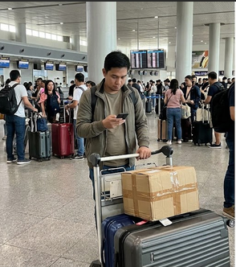
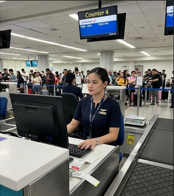

# NAIA ExpressPass: User Personas

---

## Ramon Santos, the person waiting

> "The line was so long last time that people were literally running to the gate because luggage counters were completely jammed." *(interview)*

| | |
| --- | --- |
| **Photo or sketch** | |
| **Age, role and background** | 34, Overseas Filipino Worker (OFW) returning to Dubai via Terminal 3. Commutes to NAIA from Cavite via shuttle. *(interview)* |
| **Goals** | 1. Drop off 2 heavy luggage boxes within a guaranteed time window.  2. Avoid standing in a static 2-hour queue before passing through airport security and immigration. |
| **Frustrations** | 1. Unpredictable wait times causing anxiety about gate closure.  2. Crowded waiting areas near Terminal 3 pillars with nowhere to sit or store luggage trolleys. *(observation)* |
| **Devices and context** | Mid-range Android smartphone; single-hand use while balancing a heavy baggage trolley on crowded airport Wi-Fi and mobile data. *(observation)* |
| **Tech comfort** | Medium — Uses messaging, banking, and airline apps daily, but gets frustrated by complex, multi-step navigation. |
| **Accessibility needs** | High visual contrast (outdoor sun flare near terminal drop-off area); large touch targets while holding luggage trolley with one hand. |

### Scenario

Ramon arrives at NAIA Terminal 3 two and a half hours before his flight to Dubai, pushing a heavy luggage trolley with two suitcases. Instead of joining the massive general check-in line stretching across the departures hall, he pulls out his phone, opens NAIA ExpressPass, and selects his reserved 14:15 Virtual Bag-Drop slot. He instantly sees his ticket number (A-014) and notices there are only 2 passengers ahead of him. He waits comfortably near a seating area until his phone alerts him that his ticket has been called to Counter 4.

### Top tasks in the app

| Task | Screen | Requirement ID |
| --- | --- | --- |
| Book / Join Virtual Bag-Drop queue | Join | FR-01 |
| Check live position and counter assignment | My place | FR-02 |
| Leave / Cancel bag-drop slot | My place | FR-02 |

### What this means for my interface

1. Because Ramon is balancing a heavy baggage trolley with one hand while walking through a crowded terminal, his ticket number, status badge, and assigned counter must be the largest and clearest elements on the My place screen. *(observation)*
2. Because airport terminal Wi-Fi and cellular data in Terminal 3 are often spotty and slow, status updates must refresh cleanly in the background via lightweight JSON polling without requiring a full page reload.
3. Because international flights have strict gate closure times, the interface must explicitly display his assigned flight number (`5J-501`) and slot window alongside his live position count so he can verify his slot schedule at a glance. *(interview)*

---

## Bea Bee, the staff member

> "When two international flights overlap, we need to immediately prioritize passengers whose gates close first before the baggage belt closes." *(observation)*

| | |
| --- | --- |
| **Photo or sketch** |  |
| **Age, role and background** | 26, Ground Operations Representative at NAIA Terminal 3 check-in counters. Works 8-hour shifts handling high-volume peak departure rushes. *(interview)* |
| **Goals** | 1. Process each baggage drop-off in under 90 seconds.  2. Quickly identify and prioritize urgent flight queues or special assistance lanes (OFW / Senior / PWD). |
| **Frustrations** | 1. Passengers coming to the counter out of order or outside their reserved slot times.  2. Having to navigate cluttered computer screens while tagging physical baggage items. *(observation)* |
| **Devices and context** | Shared counter desktop terminal (1080p monitor) with a barcode scanner behind the counter, used while standing under bright airport lights. |
| **Tech comfort** | High — Proficient with airline departure control systems (DCS), terminal software, and desktop shortcuts. |
| **Accessibility needs** | Full keyboard control (Tab/Enter navigation) to operate without switching to a mouse; clear table contrast under bright fluorescent lighting. |

### Scenario

Bea is managing Counter 4 during a peak afternoon rush at Terminal 3. Her desktop dashboard displays the live waiting queue filtered by active services. When a batch of passengers arrives for flight `5J-501`, she clicks "Call Next" on her dashboard to call ticket A-014 to her counter. As Ramon approaches, she verifies his booking reference (PNR) displayed on her table, weighs and tags his two bags, and clicks "Serve" to mark his ticket complete, automatically advancing the queue for the next passenger.

### Top tasks in the app

| Task | Screen | Requirement ID |
| --- | --- | --- |
| View and filter waiting tickets by lane | Staff dashboard | FR-03 |
| Call the next waiting passenger to counter | Staff dashboard | FR-03 |
| Mark ticket as served or no-show | Staff dashboard | FR-03 |

### What this means for my interface

1. Because Bea processes hundreds of baggage check-ins per shift while standing at a counter, primary actions ("Call next", "Serve") must require exactly one tap or click and support clear keyboard navigation. *(observation)*
2. Because passengers frequently approach counters out of turn, the staff dashboard table must display the passenger's Flight Number, PNR, and Slot Time in dedicated columns next to their name. *(interview)*
3. Because sudden gate emergencies require clearing specific service lanes immediately, the dashboard must feature instant service filters (Virtual Slot, Priority Lane, Walk-in) and distinct row status indicators.