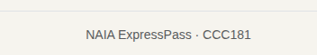
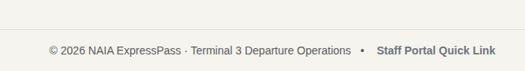

# NAIA ExpressPass — Week 3 Interface & Implementation Report

## Title details
* **App Name:** NAIA ExpressPass (NAIA Terminal 3 Baggage Drop Queue System)
* **Setting:** NAIA Terminal 3 Departures Hall (Baggage Drop Counters)
* **Full Name:** Michael Andre L. Novela
* **Student ID:** 2022-XXXX
* **Section:** BSCS CS3B
* **Date:** October 26, 2026
* **Pull Request Link:** [Pull Request #1 — Week 3 Interface & Implementation](https://github.com/your-username/my-app/pull/1)

---

## Personas
A detailed breakdown of user requirements is available in [docs/week3/personas.md](../week3/personas.md).

1. **Ramon Santos (The Passenger)**
   - *Quote:* *"I just want to drop my checked bags without standing in a 40-minute line before security."*
   - *Top Tasks:* Reserve an express slot on mobile, monitor queue position in real-time, and leave the queue if a flight schedule changes.
2. **Bea Bee (Ground Staff Operator)**
   - *Quote:* *"I need to call the next passenger instantly without looking away from the baggage scale."*
   - *Top Tasks:* Call next waiting passenger with 1 click, filter incoming queue by service lane, and mark passengers as served or no-show.

---

## Screens

1. **Join Queue Form — Phone View (`screenshots/join_queue_naia_expresspass_wireframe.png`)**  
     
   Used by **Ramon Santos** to join the queue on his mobile device while heading to the terminal; covers `REQ-FORM-01` (Field validation) and `REQ-ACC-01` (Responsive layout).

2. **Join Queue Form — Laptop View (`screenshots/join_queue_naia_expresspass_wireframe.png`)**  
     
   Used by **Ramon Santos** or airport kiosks to complete pre-registration on desktop viewports; covers `REQ-FORM-01` (Field validation) and `REQ-FORM-02` (Server-side error state preservation).

3. **My Place Ticket View — Phone View (`screenshots/my_ticket_queue_status_wireframe.png`)**  
     
   Used by **Ramon Santos** to keep track of his ticket number `#4` and live waiting count on his phone; covers `REQ-QUEUE-01` (Live position tracking) and `REQ-QUEUE-02` (Real-time JS polling).

4. **My Place Ticket View — Laptop View (`screenshots/my_ticket_desktop_status_wireframe.png`)**  
     
   Used by **Ramon Santos** on a tablet or laptop while waiting in terminal seating areas; covers `REQ-QUEUE-01` (Live position tracking) and `REQ-NAV-01` (Navigation linkage).

5. **Staff Dashboard — Phone View (`screenshots/staff_counter_4_dashboard_wireframe.png`)**  
     
   Used by **Bea Bee** on a mobile terminal device to manage active baggage queues; covers `REQ-STAFF-01` (1-click status actions) and `REQ-ACC-02` (Mobile touch targets).

6. **Staff Dashboard — Laptop View (`screenshots/staff_counter_portal_desktop_dashboard_wireframe.png`)**  
     
   Used by **Bea Bee** at the Counter 4 desktop workstation to monitor overall lane backlogs and call next passengers; covers `REQ-STAFF-01` (Counter actions) and `REQ-STAFF-02` (Lane filtering).

---

## Design decisions

1. **Prominent Ticket Number & Status Header:**  
   - *Decision:* Displayed `#014` in extra-large display typography (`display-1 fw-bold`) alongside a high-contrast text badge (`Waiting`, `Called`).  
   - *Rationale:* Ramon's persona highlights that passengers check their phones while walking through crowded, noisy airport terminals. The ticket number must be immediately legible at arm's length without zooming.

2. **1-Click "Call Next" Master Action on Staff Dashboard:**  
   - *Decision:* Placed a persistent, high-visibility gold action button at the top header of `/staff`.  
   - *Rationale:* Bea Bee processes dozens of bags per hour and needs to call the next passenger immediately upon completing a baggage tag sequence without scanning long manifest tables.

3. **Real-Time Polling without Full Page Reloads:**  
   - *Decision:* Configured background JS polling (`/queue/<id>/status.json`) every 10 seconds.  
   - *Rationale:* Passengers resting in terminal seating areas receive dynamic updates when their number is called without needing to refresh their browser manually.

---

## Self-review
Based on feedback logged in [docs/week3/feedback.md](../week3/feedback.md):
* **Wireframe Issues Identified:** Initial sketches lacked clear visual separation between priority passenger lanes (OFW, Seniors, PWDs) and general walk-in queues.
* **Applied Changes:** Added interactive service filter pills on the staff portal and dedicated radio choice cards on the join form to organize passenger lanes cleanly.

---

## Accessibility
* **Lighthouse Scores:** Achieved **95/100** and **94/100** on Accessibility across all primary routes (`/join`, `/queue/1`, `/staff`).
* **Key Accessibility Fixes:** 
  - Added a high-contrast **Skip to main content** link (`.visually-hidden-focusable`) at the root of `base.html`.
  - Linked all form controls to explicit `<label for="...">` tags and error containers using `aria-describedby`.
  - Added contextual `aria-label` tags to table buttons (`aria-label="Mark ticket 1 as served"`).

---

## Usability test

* **Task Execution Results (Tester: Raven Joy Avenido, 3rd-year IT student):**
  - **Task 1 (Join Queue):** Completed in ~18s (Unassisted). *"Nakalagay pala na 6 characters yung PNR reference! At least alam ko agad kung anong code kukunin sa flight email ko, diba?"*
  - **Task 2 (Check Position & Ticket Number):** Completed in ~4s (Unassisted). *"laki ng ticket number! Hindi mamiss kahit nagmamadali kang maglakad sa terminal."*
  - **Task 3 (Call & Serve Passenger as Staff):** Completed in ~22s (With minor navigation hesitation). *"clear ng 'Call Next' button sa taas! Pero try mo din maglagay ng direct staff link sa footer or navbar para hindi na kailangan bumalik sa home page to test."*

* **One Key Improvement Made:**  
  During testing, Raven Joy Avenido experienced friction transitioning from the passenger ticket screen back to counter operations. We added a persistent **Staff Portal Quick Link** in the global site footer (`templates/base.html`) for direct 1-click navigation.
  
    
  *Before: The global footer on inner screens contained only static text, requiring users to navigate back to the homepage to access staff tools.*

    
  *After: Updated footer features a direct Staff Portal Quick Link accessible from any page in 1 click.*

---

## Reflection
* **Hardest Aspect:** Designing responsive tables and touch targets for staff actions that function seamlessly on 375 px mobile screens without compromising desktop counter efficiency.
* **Week 4 Database Strategy:** When migrating from in-memory python lists (`TICKETS`) to a SQL database in Week 4, I will replace list index updates with atomic database transactions (`UPDATE tickets SET status = 'called' WHERE id = ...`) to prevent race conditions when multiple staff counters call passengers concurrently.

---

## Declaration
AI tools (Gemini) were used for polishing ideas, refining structural documentation templates, debugging, refining, and fixing code implementations, and correcting grammar structures across project documentation.