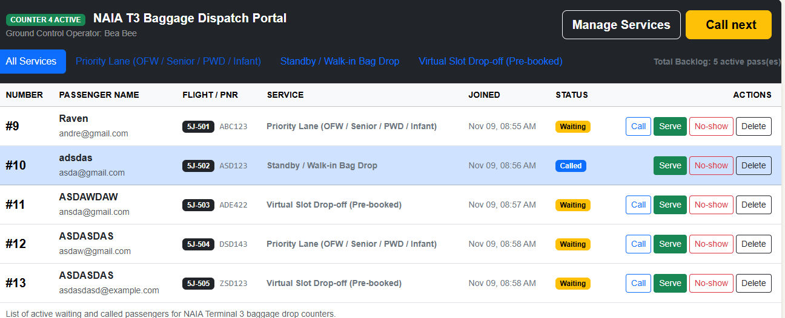
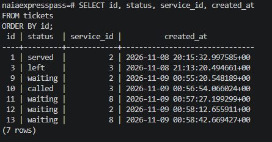
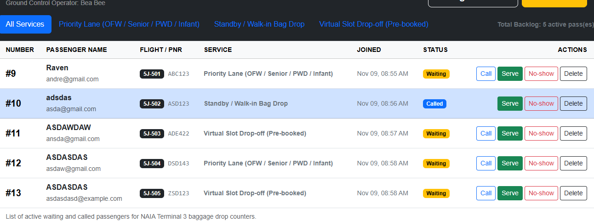
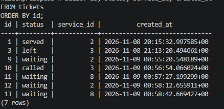

# Week 4 Persistence Test

## Restart Test

The persistence test was performed to verify that queue data remains stored after Flask and the PostgreSQL Docker container are stopped and restarted.

### Before Restart

At least five tickets were created across multiple services. Different ticket states were also tested, including waiting, called, served, and left.

The staff dashboard and PostgreSQL query were recorded before restarting the system.

```sql
SELECT id, status, service_id, created_at
FROM tickets
ORDER BY id;
```





### Restart Procedure

Flask was stopped, followed by the PostgreSQL container:

```text
docker compose down
docker compose ps
```

`docker compose ps` confirmed that no containers were running.

PostgreSQL was then started again:

```text
docker compose up -d
docker compose ps
```

After the database became healthy, Flask was started again.

### After Restart

The staff dashboard and the same PostgreSQL query were checked again.





The ticket IDs, statuses, service IDs, and creation timestamps remained unchanged after the restart. This confirms that the PostgreSQL Docker volume preserved the queue data successfully.

## Rebuild From Scratch

After completing the restart test, the PostgreSQL volume was intentionally deleted to test whether the database could be rebuilt entirely from the committed migrations.

The following commands were used:

```text
docker compose down -v
docker compose up -d
flask --app app db upgrade
flask --app app seed
```

Both migrations ran successfully:

```text
Running upgrade -> cd506a18ff29, initial tables
Running upgrade cd506a18ff29 -> d2e3e55966bc, rename services is_active to active
```

The seed command completed successfully. It was running a second time and completed without creating duplicate services.

After rebuilding the database, the Flask application started normally. The three seeded services appeared on the Join Queue form, and a new ticket was successfully created.

## Result

**PASS.**

The restart test showed that existing queue data survives a normal Docker and Flask restart. The rebuild test also showed that a completely empty database can be reconstructed using the committed migrations and seed command.