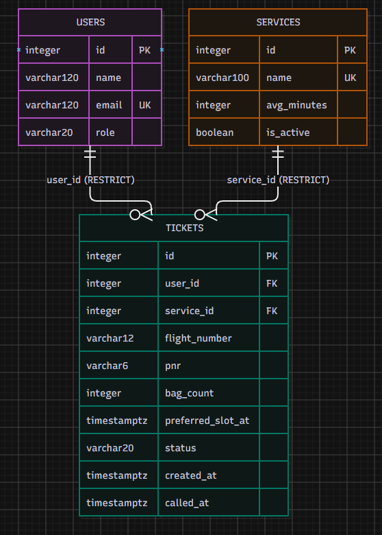
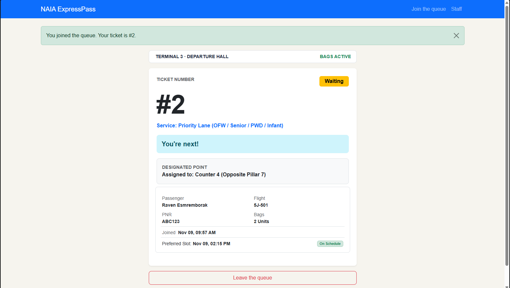
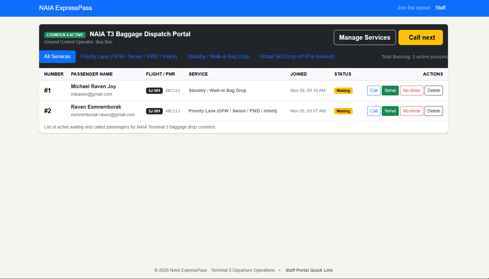
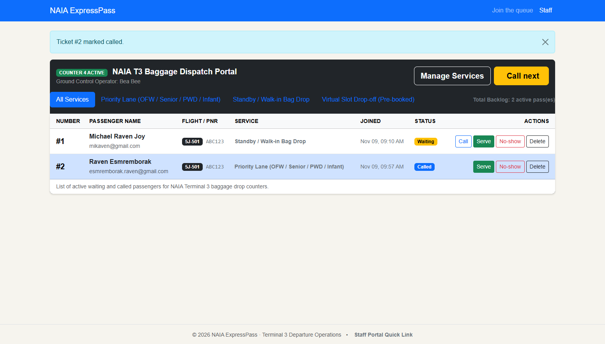
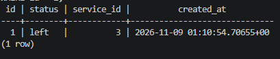
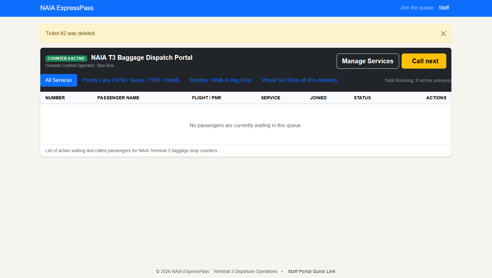
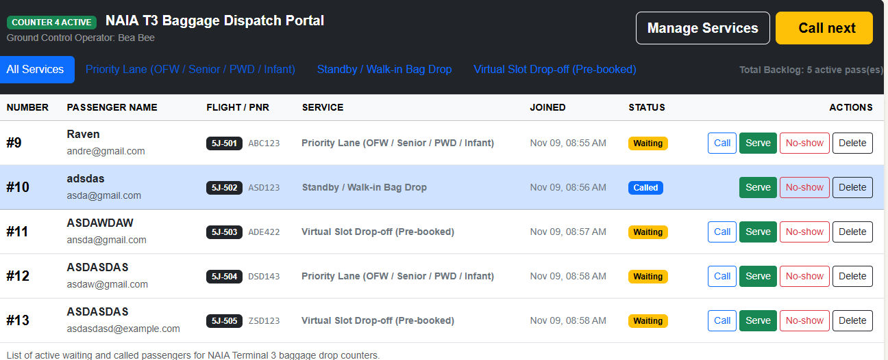
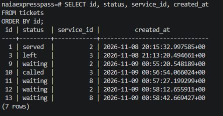
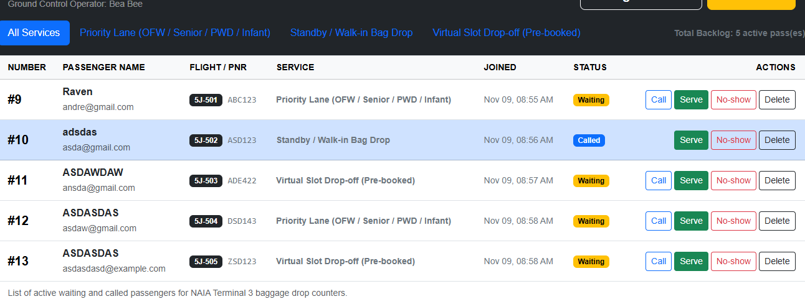
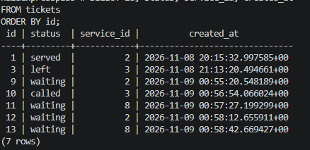

# NAIA ExpressPass — Week 4 Database Report

**Application:** NAIA ExpressPass: Terminal 3 Queue App  
**Setting:** NAIA Terminal 3 Departures Hall — baggage drop-off counters  
**Name:** Michael Andre L. Novela  
**Student ID:** 2024-1328  
**Section:** CS-3B  
**Date:** November 9, 2026  
**Pull Request:** 

## 1. Requirements

NAIA ExpressPass has **17 functional requirements** and **6 non-functional requirements**.

The minimum viable product (MVP) includes **FR-01 through FR-14**. The MVP non-functional requirements are **NFR-01, NFR-02, NFR-04, and NFR-05**.

The application focuses on the baggage drop-off queue at NAIA Terminal 3. Passengers can join a service lane, provide flight and baggage information, receive a ticket, monitor their queue status, and leave the queue when necessary. Ground staff can view active queues, call passengers, update ticket statuses, manage service lanes, and permanently remove incorrectly created tickets.

For Week 4, the requirements previously marked **This week** were FR-07, FR-12, FR-13, and FR-14. All four were implemented and their statuses were updated to **Built (Week 4)**.

Passenger feedback from the requirements interview did not identify any missing or unnecessary requirements. The interviewee identified FR-02, FR-03, and FR-11 as the three most important requirements. Since these were already classified as Must requirements and included in the MVP, no requirement priorities needed to be changed.

See the complete requirements: [requirements.md](../requirements.md)

## 2. ERD



The database contains three main entities: `users`, `services`, and `tickets`.

A **user can have many tickets**, while each ticket belongs to exactly one user through `tickets.user_id`.

A **service can have many tickets**, while each ticket belongs to exactly one service lane through `tickets.service_id`.

The `tickets` table connects passengers to baggage drop-off service lanes while storing information specific to an individual queue visit, such as flight number, PNR, bag count, preferred slot, priority verification, status, and timestamps.

The queue itself is not stored as a separate table. Queue position can be reconstructed from active tickets for a service ordered by their creation time.

See the complete schema design: [schema.md](schema.md)

## 3. Schema

The final PostgreSQL database contains the `users`, `services`, and `tickets` tables.

### `users`

```text
                                    Table "public.users"
 Column |          Type          | Collation | Nullable |              Default
--------+------------------------+-----------+----------+-----------------------------------
 id     | integer                |           | not null | nextval('users_id_seq'::regclass)
 name   | character varying(120) |           | not null |
 email  | character varying(120) |           | not null |
 role   | character varying(20)  |           | not null | 'passenger'::character varying
Indexes:
    "users_pkey" PRIMARY KEY, btree (id)
    "users_email_key" UNIQUE CONSTRAINT, btree (email)
Check constraints:
    "ck_users_role" CHECK (role::text = ANY (ARRAY['passenger'::character varying, 'staff'::character varying]::text[]))
Referenced by:
    TABLE "tickets" CONSTRAINT "tickets_user_id_fkey" FOREIGN KEY (user_id) REFERENCES users(id) ON DELETE RESTRICT
```

### `services`

```text
                                      Table "public.services"
   Column    |          Type          | Collation | Nullable |               Default
-------------+------------------------+-----------+----------+--------------------------------------
 id          | integer                |           | not null | nextval('services_id_seq'::regclass)
 name        | character varying(100) |           | not null |
 avg_minutes | integer                |           | not null | 10
 active      | boolean                |           | not null | true
Indexes:
    "services_pkey" PRIMARY KEY, btree (id)
    "services_name_key" UNIQUE CONSTRAINT, btree (name)
Check constraints:
    "ck_services_avg_minutes" CHECK (avg_minutes > 0)
Referenced by:
    TABLE "tickets" CONSTRAINT "tickets_service_id_fkey" FOREIGN KEY (service_id) REFERENCES services(id) ON DELETE RESTRICT
```

### `tickets`

```text
                                          Table "public.tickets"
      Column       |           Type           | Collation | Nullable |               Default
-------------------+--------------------------+-----------+----------+-------------------------------------
 id                | integer                  |           | not null | nextval('tickets_id_seq'::regclass)
 user_id           | integer                  |           | not null |
 service_id        | integer                  |           | not null |
 flight_number     | character varying(12)    |           | not null |
 pnr               | character varying(6)     |           | not null |
 bag_count         | integer                  |           | not null |
 preferred_slot_at | timestamp with time zone |           |          |
 priority_verified | boolean                  |           | not null | false
 status            | character varying(20)    |           | not null | 'waiting'::character varying
 created_at        | timestamp with time zone |           | not null | now()
 called_at         | timestamp with time zone |           |          |
Indexes:
    "tickets_pkey" PRIMARY KEY, btree (id)
Check constraints:
    "ck_tickets_bag_count" CHECK (bag_count >= 1 AND bag_count <= 5)
    "ck_tickets_pnr_length" CHECK (char_length(pnr::text) = 6)
    "ck_tickets_status" CHECK (status::text = ANY (ARRAY['waiting'::character varying, 'called'::character varying, 'served'::character varying, 'no-show'::character varying, 'left'::character varying]::text[]))
Foreign-key constraints:
    "tickets_service_id_fkey" FOREIGN KEY (service_id) REFERENCES services(id) ON DELETE RESTRICT
    "tickets_user_id_fkey" FOREIGN KEY (user_id) REFERENCES users(id) ON DELETE RESTRICT
```

## 4. Design Decisions

### Decision 1 — Store queue facts instead of calculated queue results

The database stores ticket facts such as `service_id`, `status`, and `created_at`, but it does not store queue position or the number of passengers ahead.

Queue position changes whenever another passenger joins, leaves, is called, or is served. Storing the calculated position could result in stale or inconsistent values. Instead, the application calculates a passenger's position using the current active tickets for the selected service.

This supports FR-05 while keeping the database consistent.

### Decision 2 — Preserve ticket history with status values and restricted deletion

A passenger leaving the queue does not normally delete the ticket. FR-07 requires the ticket to remain in the database with a distinct `left` status. Other workflow outcomes such as `served` and `no-show` are also stored as ticket statuses.

Foreign keys from `tickets` to `users` and `services` use `ON DELETE RESTRICT`. This prevents a referenced user or service from being deleted accidentally and preserves historical queue records. This decision also supports FR-14, which permits deletion of a service lane only when no tickets reference it.

### Decision 3 — Separate users, services, and individual queue visits

Passenger information is stored in `users`, service-lane information is stored in `services`, and information about a specific baggage-drop visit is stored in `tickets`.

For example, a passenger's email is not copied into every ticket, and a service's name is not stored directly in each ticket. Instead, `user_id` and `service_id` establish the relationships.

This reduces duplicated data while supporting both the passenger persona, who needs access to an individual queue ticket, and the ground staff persona, who needs to organize tickets by service lane.

## 5. Self-Review

The schema was reviewed for requirement coverage, duplication, calculated data, bad-data prevention, delete behavior, and appropriate data types.

One important issue found during the review was that FR-17 was marked as storing data, but the original schema had no field for recording whether Priority Lane eligibility had been verified. The `priority_verified` boolean column was therefore added to `tickets`.

The review also confirmed that user and service information should not be duplicated in `tickets`. Foreign keys are used instead. Calculated information such as queue position, passengers ahead, estimated waiting time, and daily totals is also not stored because these values can be reconstructed from ticket records.

Several database constraints were included to prevent bad data. These include unique user emails and service names, a six-character PNR constraint, a bag count from 1 to 5, valid ticket statuses, and a positive average service time.

Delete behavior was also reviewed. Both ticket foreign keys use `ON DELETE RESTRICT` so deleting a user or service cannot silently remove historical tickets.

Finally, time-related information uses PostgreSQL `timestamptz` instead of plain text. This includes `preferred_slot_at`, `created_at`, and `called_at`.

See the full review: [schema-review.md](schema-review.md)

## 6. Migrations

Two database migrations were created for Week 4.

### Migration 1 — Initial tables

**Revision:** `cd506a18ff29`  
**File:** `cd506a18ff29_initial_tables.py`

This migration created the initial `users`, `services`, and `tickets` database tables together with their primary keys, foreign keys, constraints, defaults, and relationships.

### Migration 2 — Rename service active column

**Revision:** `d2e3e55966bc`  
**File:** `d2e3e55966bc_rename_services_is_active_to_active.py`

This migration renamed the service activation column from `is_active` to `active` so the database schema matched the final SQLAlchemy model and application code.

The migration history was tested by applying the migrations to PostgreSQL, and the clean rebuild test later confirmed that the complete database can be recreated from the migration files.

## 7. CRUD Operations

### Create

A passenger can create a queue ticket by submitting the Join Queue form. The application creates the required passenger and ticket data in PostgreSQL and then displays the passenger's ticket page.

**Requirements:** FR-01, FR-02, FR-03, FR-04  
**Route:** Join Queue form and ticket creation route



### Read

The application reads persisted tickets from PostgreSQL for both passengers and staff. A passenger can view their ticket information and queue position, while staff can view active tickets and filter them by service lane.

**Requirements:** FR-05, FR-08, FR-11  
**Routes:** `/queue/<ticket_id>` and `/staff`



### Update

Staff can update a ticket's status as it moves through the queue workflow. Calling a passenger changes the status from `waiting` to `called`. Tickets can also be marked `served` or `no-show`.

**Requirements:** FR-09, FR-10  
**Route:** Staff ticket action from `/staff`



### Soft Delete

When a passenger chooses to leave the queue, the ticket is retained in PostgreSQL but its status changes to `left`. This preserves the historical ticket record instead of deleting it.

**Requirement:** FR-07  
**Route:** Leave Queue action from `/queue/<ticket_id>`



### Hard Delete

Staff can permanently delete an incorrectly created ticket. The action requires confirmation before the delete request is submitted.

**Requirement:** FR-13  
**Route:** Permanent ticket delete action from the staff dashboard



Service management additionally provides create, update, deactivate, and restricted delete operations for service lanes under FR-12 and FR-14.

## 8. Validation

Validation was tested at three layers: the browser, Flask, and PostgreSQL.

At the browser layer, the join form uses HTML validation including required fields, email input validation, maximum lengths, a six-character PNR, and a checked-bag range from 1 to 5.

At the Flask layer, invalid requests are checked before data is committed. A direct invalid request was tested and returned:

```text
HTTP/1.1 400 BAD REQUEST
```

At the PostgreSQL layer, database constraints were deliberately violated to verify that invalid data is rejected. Tests included the ticket bag-count CHECK constraint, PNR-length CHECK constraint, ticket-status CHECK constraint, foreign-key constraint, UNIQUE service-name constraint, NOT NULL constraint, and foreign-key delete restriction.

The most useful PostgreSQL error was the foreign-key restriction produced when attempting to delete a service that still had tickets:

```text
ERROR: update or delete on table "services" violates foreign key constraint "tickets_service_id_fkey" on table "tickets"
```

This was particularly useful because it demonstrated that FR-14 is enforced not only by the Flask interface but also by PostgreSQL itself. Even if application-level validation were bypassed, the database would prevent a referenced service from being deleted.

A source-code check was also performed for manually constructed SQL statements using:

```text
git grep -nE "f[\"'].*(SELECT|INSERT|UPDATE|DELETE)" -- "*.py"
```

The command produced no matches.

See the complete validation record: [validation.md](validation.md)

## 9. Persistence

Persistence was tested by creating multiple tickets across multiple service lanes and assigning different statuses before restarting the application and PostgreSQL.

Before the restart, the database contained tickets with statuses including `served`, `left`, `waiting`, and `called`.





Flask was stopped and the PostgreSQL container was shut down using:

```text
docker compose down
```

`docker compose ps` confirmed that the container was no longer running. PostgreSQL was then restarted using:

```text
docker compose up -d
```

After PostgreSQL became healthy, Flask was started again.





The ticket IDs, statuses, service IDs, and `created_at` timestamps were unchanged after the restart. This confirms that the application data is stored persistently in PostgreSQL rather than only in Flask memory.

A second test verified that the project could be rebuilt from an empty database volume. The following commands were used:

```text
docker compose down -v
docker compose up -d
flask --app app db upgrade
flask --app app seed
```

Both migrations were successfully applied:

```text
Running upgrade  -> cd506a18ff29, initial tables
Running upgrade cd506a18ff29 -> d2e3e55966bc, rename services is_active to active
```

The seed command successfully restored the three default service lanes. It was also run twice and remained safe, displaying `Services are ready.` without creating unwanted duplicate services.

After the rebuild, the application opened successfully, all three seeded service lanes appeared in the Join Queue form, and a new ticket could be created.

**NFR-01 result: PASS.** Ticket IDs, passenger data, ticket statuses, service assignments, and timestamps survived a normal Flask and PostgreSQL restart without deleting the database volume.

See the full persistence test: [persistence.md](persistence.md)

## 10. Reflection

The hardest part of Week 4 was moving the application from temporary in-memory data to a real PostgreSQL database without breaking the queue workflow that already existed. Database persistence required more than simply creating tables. The models, migrations, relationships, validation, delete behavior, seed data, and Flask routes all had to agree with one another.

The requirement that was hardest to make testable was the delete behavior for service lanes. FR-14 says that a service can only be deleted when no tickets reference it. To make this reliable, I implemented the rule at both the application and database levels. The application prevents the normal delete action when tickets exist, while PostgreSQL's `ON DELETE RESTRICT` provides a second layer of protection. Deliberately attempting the invalid deletion helped verify that the rule was actually enforced.

For Week 5, one report that would be useful to the ground staff persona is a **daily queue performance report by service lane**. It could show how many passengers joined each lane, how many were served, how many were marked no-show, and how many left before being served. This would help staff identify which baggage drop-off lanes experience the most demand or passenger abandonment.

## 11. Declaration

Gemini and Chatgpt was used during Week 4 to help explain assignment instructions, troubleshoot Flask, PostgreSQL, migration, and Git commands, and organize parts of the project documentation. No AI-generated test result or database output was presented as if it had been executed when it had not been.

## 12. Week 4 Result

The Week 4 database implementation successfully replaced the application's temporary queue storage with PostgreSQL persistence.

The application now supports persistent passenger, service, and ticket records; database-backed create, read, update, soft-delete, and hard-delete operations; service-lane management; three-layer validation; database constraints; reproducible migrations; idempotent seed data; and persistence across normal PostgreSQL and Flask restarts.

The four requirements originally marked **This week** — FR-07, FR-12, FR-13, and FR-14 — are now marked **Built (Week 4)**.

The normal restart persistence test and clean database rebuild test both passed.