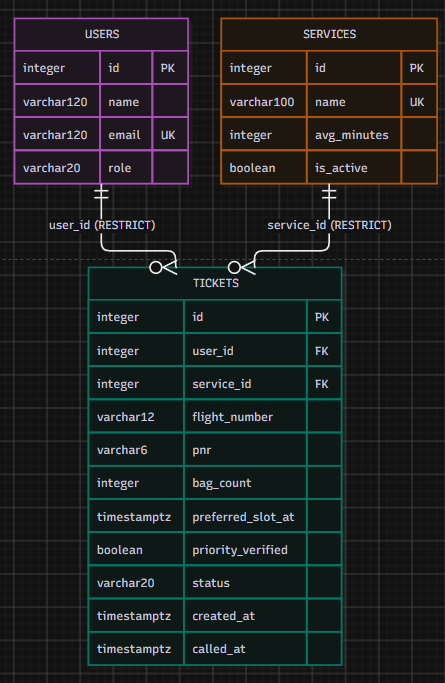

# NAIA ExpressPass Database Schema

## Part 2: Design the Schema and Draw the ERD

This schema is for **NAIA ExpressPass**, a baggage-drop queue management application for passengers and staff at NAIA Terminal 3.

The design follows the Week 4 requirement that the queue itself should **not** be stored as a separate table. A queue is represented by tickets with an active status for a specific service, ordered by the time each ticket was created. Queue position and the number of people ahead are computed when needed rather than stored.

---

## 2a. Find the nouns in the requirements

The following requirements are the requirements from Part 1 marked **Stores data? = Yes**. Important nouns are shown in bold.

| Req ID | Requirement | Nouns | Table or column? |
| --- | --- | --- | --- |
| FR-01 | A **passenger** can join the queue by entering their **name** and **email**. | passenger, name, email, queue | `users`, `users.name`, `users.email`, *(queue is computed, not a table)* |
| FR-02 ★ | A passenger can provide their **flight number**, six-character **PNR**, and **bag count**. | flight number, PNR, bag count | `tickets.flight_number`, `tickets.pnr`, `tickets.bag_count` |
| FR-03 ★ | A passenger can select a baggage-drop **service lane**. | service lane | `services` and `tickets.service_id` |
| FR-04 ★ | A passenger can provide a **preferred slot** and see it on their ticket. | preferred slot | `tickets.preferred_slot_at` |
| FR-05 | A passenger can view their **ticket number**, **status**, **service**, and number of people **ahead**. | ticket number, status, service, ahead | `tickets.id`, `tickets.status`, `services`; *ahead is computed* |
| FR-06 | A passenger can see their automatically updated **status** and queue **position**. | status, position | `tickets.status`; *position is computed* |
| FR-07 | A passenger can leave the queue and the ticket is marked **left**. | passenger, ticket, status | `users`, `tickets`, `tickets.status` |
| FR-08 | A **staff member** can view and filter active **tickets** by **service lane**. | staff member, tickets, service lane | `users.role`, `tickets`, `services` |
| FR-09 | A staff member can call the next waiting **ticket** and mark its **status** as called. | ticket, status | `tickets`, `tickets.status`, `tickets.called_at` |
| FR-10 | A staff member can mark a ticket as **served** or **no-show**. | ticket, status | `tickets.status` |
| FR-11 ★ | A staff member can view a passenger's **flight number**, **PNR**, **bag count**, and **preferred slot**. | flight number, PNR, bag count, preferred slot | columns in `tickets` |
| FR-12 | A staff member can create a baggage-drop **service lane**. | service lane | `services` |
| FR-13 | A staff member can permanently delete a mistaken **ticket** after confirmation. | ticket | `tickets` |
| FR-14 | A staff member can delete a **service lane** only when no **tickets** reference it. | service lane, tickets | `services`, `tickets.service_id`, `ON DELETE RESTRICT` |
| FR-15 | A staff member can view the daily number of **left tickets** per **service lane**. | tickets, service lane, daily count | `tickets.status`, `tickets.created_at`, `services`; *count is computed* |
| FR-16 ★ | A passenger can reserve a **preferred slot** only when capacity is available. | preferred slot, capacity | `tickets.preferred_slot_at`; capacity rule is enforced by application logic |
| FR-17 ★ | A staff member can verify **priority eligibility** for a passenger. | priority eligibility | Not represented in the current MVP ERD; this is a later requirement and would need an additional column or table before implementation. |

### Candidate tables

The stored nouns group naturally into three related tables:

1. `users` — information about passengers and staff.
2. `services` — baggage-drop service lanes.
3. `tickets` — information about one passenger's queue visit.

The **queue is not a table**. It is derived from active tickets for a service ordered by `created_at`.

---

## 2b. List your tables and columns

Starting from the three tables in the template, the tables are adapted to fit the **NAIA ExpressPass** baggage-drop queue setting:

| Table | NAIA ExpressPass columns |
| --- | --- |
| `users` | id, name, email, role |
| `services` | id, name, avg_minutes, is_active |
| `tickets` | id, user_id, service_id, flight_number, pnr, bag_count,
preferred_slot_at, priority_verified, status, created_at, called_at |

The schema uses **three related tables**:

- `users` stores information about the people using the system, including passengers and staff.
- `services` stores the available baggage-drop service lanes, such as Virtual Slot Drop-off, Priority Lane, and Standby / Walk-in Bag Drop.
- `tickets` stores information about one passenger's baggage-drop visit. The flight number, PNR, bag count, preferred slot, status, and timestamps belong here because these details may be different each time a passenger joins the queue.

The `tickets` table connects to `users` through `user_id` and to `services` through `service_id`. 

A separate table for the **queue** is not needed. The queue can be determined from tickets with an active status for a particular service, ordered by `created_at`. Values such as queue position and the number of people ahead are also computed rather than stored.

---

## 2c. PostgreSQL types and constraints

| Table | Column | PostgreSQL type | Constraint | Why |
| --- | --- | --- | --- | --- |
| `users` | `id` | `integer`, generated | `PRIMARY KEY` | Gives every user a unique database-generated identifier. |
| `users` | `name` | `varchar(120)` | `NOT NULL` | Every passenger or staff record must have a name. |
| `users` | `email` | `varchar(120)` | `NOT NULL UNIQUE` | Prevents missing email addresses and duplicate user emails. |
| `users` | `role` | `varchar(20)` | `NOT NULL CHECK (role IN ('passenger', 'staff'))` | Only valid application roles are stored. |
| `services` | `id` | `integer`, generated | `PRIMARY KEY` | Gives every baggage-drop service a unique identifier. |
| `services` | `name` | `varchar(100)` | `NOT NULL UNIQUE` | Every service needs a name and duplicate lane names are not allowed. |
| `services` | `avg_minutes` | `integer` | `NOT NULL CHECK (avg_minutes > 0)` | Service time must be a positive number of minutes. |
| `services` | `is_active` | `boolean` | `NOT NULL DEFAULT TRUE` | A service is active unless staff explicitly switch it off. |
| `tickets` | `id` | `integer`, generated | `PRIMARY KEY` | Serves as the unique ticket number and is generated by the database. |
| `tickets` | `user_id` | `integer` | `NOT NULL REFERENCES users(id) ON DELETE RESTRICT` | Every ticket must belong to a valid user. Restrict preserves ticket history. |
| `tickets` | `service_id` | `integer` | `NOT NULL REFERENCES services(id) ON DELETE RESTRICT` | Every ticket must belong to an existing service. Restrict prevents deletion of a referenced service. |
| `tickets` | `flight_number` | `varchar(12)` | `NOT NULL` | Every baggage-drop ticket must identify the passenger's flight. |
| `tickets` | `pnr` | `varchar(6)` | `NOT NULL CHECK (char_length(pnr) = 6)` | The current NAIA ExpressPass form requires a six-character PNR. |
| `tickets` | `bag_count` | `integer` | `NOT NULL CHECK (bag_count BETWEEN 1 AND 5)` | Matches the application's allowed baggage count of 1 to 5 bags. |
| `tickets` | `preferred_slot_at` | `timestamptz` | Nullable | Some services may not require a preferred slot. A real timestamp is used instead of text. |
| `tickets` | `status` | `varchar(20)` | `NOT NULL CHECK (status IN ('waiting', 'called', 'served', 'no-show', 'left'))` | Prevents invalid ticket states. |
| `tickets` | `created_at` | `timestamptz` | `NOT NULL DEFAULT now()` | Records when the passenger joined using a timezone-safe timestamp. |
| `tickets` | `called_at` | `timestamptz` | Nullable | Filled only when staff call the passenger. |
| `tickets` | `priority_verified` | `boolean` | `NOT NULL DEFAULT FALSE` | Records whether staff verified the passenger's Priority Lane eligibility. |

### Constraint coverage

This schema uses every constraint required by Part 2:

- **PRIMARY KEY** — `users.id`, `services.id`, `tickets.id`
- **FOREIGN KEY** — `tickets.user_id`, `tickets.service_id`
- **NOT NULL** — used on required user, service, and ticket data
- **UNIQUE** — `users.email`, `services.name`
- **CHECK** — `users.role`, `services.avg_minutes`, `tickets.pnr`, `tickets.bag_count`, `tickets.status`
- **timestamptz** — `tickets.preferred_slot_at`, `tickets.created_at`, `tickets.called_at`

### Preferred slot implementation note

The Week 3 application accepted the preferred time window as user input. For the database version, the value will be converted into a valid date-and-time value before it is saved in `tickets.preferred_slot_at`. PostgreSQL will therefore store it as `timestamptz` rather than free-text.

---

## 2d. ERD and relationships

### Relationship sentences

**Users and Tickets**

One user can have zero or many tickets. Each ticket belongs to exactly one user.

This is a **1 : N** relationship. The foreign key is `tickets.user_id`, which is located on the many side.

**Services and Tickets**

One service can have zero or many tickets. Each ticket belongs to exactly one service.

This is a **1 : N** relationship. The foreign key is `tickets.service_id`, which is located on the many side.

### Delete rules

| Foreign key | Delete rule | Reason |
| --- | --- | --- |
| `tickets.user_id → users.id` | `RESTRICT` | A user cannot be deleted while tickets still reference that user. This avoids accidentally deleting ticket history. |
| `tickets.service_id → services.id` | `RESTRICT` | A service cannot be deleted while tickets still reference it. This directly supports FR-14 and preserves historical queue records. |

`CASCADE` is not used because deleting a user or service should not automatically erase old baggage-drop tickets.

`SET NULL` is not used because every ticket must continue to identify the user and service associated with that visit.

---

## 2e. Normalization check

### 1NF — One value per cell

**Question:** Does any column contain a list, such as multiple services or several values in one field?

**Answer:** No. Each column stores one atomic value. For example, one ticket has one `flight_number`, one `pnr`, one `bag_count`, one `service_id`, and one `status`. A passenger who joins again receives another ticket rather than adding another visit to the same field.

Therefore, the schema satisfies **First Normal Form (1NF)**.

### 2NF — Depends on the whole key

**Question:** In a join table, does every non-key column depend on the complete key?

**Answer:** The current design does not require a many-to-many join table. Each table has a single-column primary key, and every non-key attribute describes the row identified by that key.

For example, `flight_number`, `pnr`, `bag_count`, and `status` all describe one specific ticket identified by `tickets.id`.

Therefore, there is no partial dependency and the schema satisfies **Second Normal Form (2NF)**.

### 3NF — No hidden copies

**Question:** Is the same fact stored in more than one place?

**Answer:** No. User information is stored once in `users`, service information is stored once in `services`, and visit-specific queue information is stored in `tickets`.

For example:

- A user's email is not copied into every ticket.
- A service name is not copied into every ticket.
- Queue position is not stored because it can be calculated.
- Daily counts are not stored because they can be calculated from ticket status and creation time.

Therefore, the design avoids unnecessary duplicated facts and satisfies **Third Normal Form (3NF)**.

